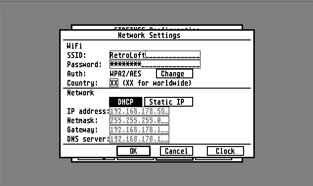

# SideTNFS Configuration Tool

> **This repository is part of [SideTNFS-Firmware](https://github.com/RetroLoft/SideTNFS-Firmware).** It is not a standalone product: it builds `SIDETNFS.PRG`, and the firmware repository embeds that exact binary into the Pico's own flash memory as a C byte array, so it can hand it to the Atari as a virtual disk. See [How this gets into the firmware](#how-this-gets-into-the-firmware) below for the full picture.

## What this is

SideTNFS is a cartridge for the Atari ST family that emulates a GEMDOS hard drive over WiFi (TNFS) or a microSD card, using a Raspberry Pi Pico. The Pico has no screen or keyboard of its own, so it needs some other way to be configured — that's what this program is for.

Every SideTNFS cartridge always exposes a small, read-only **SETTINGS disk** (default drive `S:`), even on a Pico that has never seen a network or an SD card. That disk contains exactly two files: `README.TXT` and **`SIDETNFS.PRG`**, the GEM application built from this repository. Run it from the Atari desktop and it talks directly to the running firmware over the cartridge's own ROM3 bus — there is no local config file anywhere — to add, edit, enable/disable, or remove TNFS/SD drives, change WiFi settings, and set the clock/NTP timezone. Save writes straight to the Pico's internal flash; changes take effect once the Sidecart restarts.

Because the SETTINGS disk has to be there and usable from the very first boot — before any drive, network, or storage backend exists to read files from — its contents can't be loaded from a filesystem at startup the way a normal TNFS or SD drive's files are. Instead, `SideTNFS-Firmware` compiles `SIDETNFS.PRG` (and `README.TXT`) directly into its own firmware image, as a `const uint8_t[]` array baked into flash, and serves that memory back to the Atari through a small, read-only, root-only virtual-drive backend — no RAM copy, no SD/WiFi access, nothing ever written back to it. In other words: **this repository is where the tool is developed and released, but a build of it only ever reaches a real cartridge by being embedded into that other project's firmware binary.**

## Screenshot



*(the WiFi/Network editor, one of `SIDETNFS.PRG`'s configuration screens)*

## Requirements

Building `SIDETNFS.PRG` needs a cross-compiler that runs *on your Linux/PC
and outputs Atari ST 68000/TOS binaries* -- an ordinary `gcc` cannot do
this, since the Atari's CPU and OS are nothing like the machine you're
building on.

- **Toolchain: `m68k-atari-mint-gcc`**, part of the "MiNT cross-tools"
  toolchain for Atari ST/TT/Falcon development, maintained by Vincent
  Rivière. Two ways to get it, depending on your platform:

  **Option A -- native package (Debian/Ubuntu only), via a Launchpad PPA:
  <https://launchpad.net/~vriviere/+archive/ubuntu/ppa>**
  ```
  sudo add-apt-repository ppa:vriviere/ppa
  sudo apt update
  sudo apt install cross-mint-essential gemlib-m68k-atari-mint mintlib-m68k-atari-mint
  ```
  `cross-mint-essential` pulls in the compiler itself
  (`gcc-m68k-atari-mint`) plus the matching assembler/linker
  (`binutils-m68k-atari-mint`, `mintbin-m68k-atari-mint`).
  `gemlib-m68k-atari-mint` and `mintlib-m68k-atari-mint` are the GEM and C
  library headers/archives this project's `#include <gem.h>` etc. and
  linking (`-lgem`) need -- both are required alongside the compiler.

  Everything installs under standard system paths -- the compiler as
  `/usr/bin/m68k-atari-mint-gcc` (on your `PATH` already), its headers and
  libraries under `/usr/m68k-atari-mint/`. **No environment variable or
  sysroot needs to be set** for the toolchain itself; once installed,
  `make` in this repository just works.

  **Option B -- Windows, macOS, or any Linux without that PPA: a Docker
  image of the same toolchain,
  [`atarist-toolkit-docker`](https://github.com/sidecartridge/atarist-toolkit-docker)**
  (from the same `sidecartridge`/RetroLoft project family this repository
  belongs to). It bundles `m68k-atari-mint-gcc` plus `vasm`/`vlink`,
  driven through a small `stcmd` wrapper that runs commands inside the
  container:
  ```
  # Linux/macOS installer
  curl -sL https://github.com/sidecartridge/atarist-toolkit-docker/releases/download/latest/install_atarist_toolkit_docker.sh | bash

  # Windows: download and run from the releases page
  # https://github.com/sidecartridge/atarist-toolkit-docker/releases/latest
  #   install_atarist_toolkit_docker.cmd
  ```
  Once installed, build this repository through it instead of a bare
  `make`:
  ```
  stcmd make
  ```

  `stcmd` needs to know which folder on your machine to mount into the
  container -- by default it mounts the current directory, which is what
  the `ST_WORKING_FOLDER` environment variable overrides when set. On
  Linux/macOS this default is normally enough and you can skip it
  entirely; **on Windows, set it explicitly before running `stcmd`**,
  pointed at this repository's checkout, e.g. from Command Prompt:
  ```
  cd path\to\SideTNFS-Config
  set ST_WORKING_FOLDER=%cd%
  ```
  or, from a POSIX-style shell such as Git Bash:
  ```
  cd path/to/SideTNFS-Config
  export ST_WORKING_FOLDER=`pwd`
  ```

## Build

```
make
```

Output: `SIDETNFS.PRG`. This default target (`all`) also *installs* the
build afterwards -- see `INSTALLDIR` below -- so on a fresh checkout,
plain `make` will fail at that last copy step until you've pointed
`INSTALLDIR` at a real location on your machine. To just build, without
installing anywhere, run `make SIDETNFS.PRG` instead.

### `INSTALLDIR` -- where a build gets copied to

The `Makefile`'s `INSTALLDIR` variable is this repository's own local
working directory for testing: after every successful `make`, both
`SIDETNFS.PRG` and `README.TXT` are copied there (see `DISTFILES`),
so they can be picked up by a real Atari/emulator's SETTINGS disk without
a manual copy step every time. It defaults to this project's own share
(`/mnt/retroloft/retro/Atari.ST/CONFIG`), which almost certainly doesn't
exist on your machine -- change it at the top of the `Makefile` to
wherever *your* Atari or emulator (e.g. Hatari) mounts its SETTINGS disk
from, or drop the `install` dependency from the `all` target entirely if
you'd rather just build.

## Clean

```
make clean
```

## Run

Transfer `SIDETNFS.PRG` to an Atari ST (or emulator such as Hatari) and run from the GEM desktop.

## Configuration source of truth

There is no local config file. On startup the tool tries to detect
SideTNFS firmware (protocol v3) on the cartridge; if found and consistent,
the configuration is read entirely from the firmware's RAM/flash config and
shown as-is. If no firmware is found (or its configuration is unusable),
the overview falls back to a built-in default (a SETTINGS disk plus a
RetroLoft TNFS drive) held only in memory for that session.

Save always writes straight to the Pico: RAM staging, then a single
`SAVE_CONFIG` flash write, then a full readback verification before
reporting success. Without firmware detected, Save has nowhere to write
to and reports a clear error instead.

## Drives

`SIDETNFS.PRG` configures SideTNFS.

- The **SETTINGS disk** is always present and read-only; its default
  drive letter is `S:`.
- Up to eight ordinary TNFS/SD drives can be configured, each
  **Active** or **Inactive**. Setting a drive to Inactive keeps its full
  configuration -- it is simply not published as a GEMDOS drive.
- **Remove** clears a drive's slot completely; you will need to re-enter
  its details if you want it back.
- Changes only take effect after **Save**, and only become active once
  the Sidecartridge itself restarts.

## Release assets

**Important:** `README.TXT` (the SETTINGS-disk-facing readme, distinct
from this file) must always be published as a release asset alongside
`SIDETNFS.PRG` -- never release the `.PRG` on its own. `make`/`make
install` already copies both together (see `DISTFILES` in the
`Makefile`); keep that in sync if the release process changes.

This matters beyond convenience: as described below, `SideTNFS-Firmware`'s
default embedding step pulls both files straight from this repository's
**latest GitHub release**, so a release missing either asset breaks that
process for everyone building the firmware from source.

## How this gets into the firmware

`SideTNFS-Firmware`'s `romemul/download_sidetnfs_config_drive.py` turns
`SIDETNFS.PRG` and `README.TXT` into `romemul/sidetnfs_config_drive.c` --
a plain, byte-exact C array for each file, with its length and a SHA-256
checksum recorded in a comment above it, compiled straight into the Pico
firmware image. That generated file is committed to the firmware repo
(the script is not run automatically by the build) so offline builds stay
reproducible.

By default, with no arguments, the script downloads both files from this
repository's [latest GitHub release](https://github.com/RetroLoft/SideTNFS-Config/releases/latest)
-- that is the supported, production path: publish a release here with
`SIDETNFS.PRG` and `README.TXT` as assets, then regenerate and rebuild the
firmware from it.

### Getting your own modified `SIDETNFS.PRG` into the firmware

To try out a local change to this tool on real (or emulated) hardware,
before cutting a release:

1. **Build your modified tool** in this repository:

   ```
   make SIDETNFS.PRG
   ```

   (plain `make` also works, but additionally tries to install the build
   to `INSTALLDIR` -- see [Build](#build) above.)

2. **Regenerate the embedded C array** from a checkout of
   `SideTNFS-Firmware`, pointing the generator at your local build instead
   of a release:

   ```
   cd SideTNFS-Firmware/romemul
   python3 download_sidetnfs_config_drive.py \
       --prg    ../../SideTNFS-Config/SIDETNFS.PRG \
       --readme ../../SideTNFS-Config/README.TXT
   ```

   (Adjust the relative paths if the two repositories aren't checked out
   next to each other.) This overwrites `romemul/sidetnfs_config_drive.c`
   with your build, byte-for-byte, and prints each file's size and SHA-256
   so you can confirm exactly what went in.

3. **Rebuild and flash the firmware** as usual -- see
   `SideTNFS-Firmware`'s own `build.sh`/README. The new SETTINGS disk
   contents are now part of that firmware image.

4. Treat step 2's result as local/throwaway: don't commit a
   `sidetnfs_config_drive.c` generated from an unreleased build.
   `SideTNFS-Firmware`'s committed copy is meant to always trace back to a
   published `SideTNFS-Config` release -- once your change is ready,
   publish it as a proper release here first (see
   [Release assets](#release-assets) above), then regenerate
   `sidetnfs_config_drive.c` from that release (running the script with no
   `--prg`/`--readme`) before committing it in the firmware repo.
